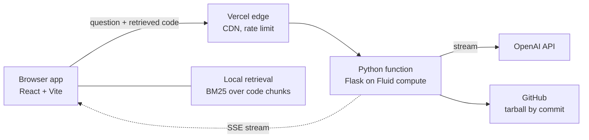

# CodeRepoReader

**Chat with any codebase.** Paste a public GitHub link or upload a ZIP, then ask questions in plain English. Answers stream in, cite the exact files and lines they come from, and can draw architecture diagrams.

**Live app → [codereporeader.vercel.app](https://codereporeader.vercel.app)**


---

## Features

- **Streaming answers.** Tokens arrive as they're written, with a Stop button, Regenerate, and edit-and-resend.
- **Answers that cite their sources.** Citations like `api/index.py:139–229` are clickable and open the file at those lines.
- **No visible token limits.** Each question retrieves the most relevant code from the whole repository. Older turns are condensed instead of dropped, and an answer that hits the output cap continues automatically in the same stream.
- **Fast and Deep modes.** Fast uses GPT-5.6 Luna for quick answers. Deep uses GPT-5.6 Terra, reads about three times more code, and reasons longer.
- **@file attachments.** Type `@` to attach a file so the answer reads all of it.
- **Diagrams.** Ask for an architecture or request-flow diagram and it renders as Mermaid in the chat.
- **Repository panel.** Stats, languages, stack, entry points, HTTP routes, a file tree, symbol search and a syntax-highlighted file viewer.
- **Chats are saved in the browser.** Multiple chats per repository, search, export to Markdown. Nothing is stored on the server.
- **Graphite theme** in dark and light, keyboard shortcuts, and a mobile layout.

## How it works



1. **Resolve.** `/api/resolve` turns a GitHub link into an exact commit SHA.
2. **Analyze once per commit.** `/api/analyze` downloads that commit's tarball into memory and runs static analysis: Python `ast` plus language-aware patterns for JS/TS, Java, Kotlin, C#, Go, Rust, Ruby, PHP and Swift. It returns stats, symbols, routes, a compact repository map, and the source files. A commit never changes, so **Vercel's CDN caches the result**: a popular repository is analyzed once and served to everyone after that.
3. **Retrieve in the browser.** The browser indexes the code with BM25 and code-aware boosts for identifiers, file names and symbols. For each question it sends only the best excerpts. That keeps requests small and cheap, and it scales with the number of users at no extra cost.
4. **Answer on the server.** `/api/chat` builds a prompt with a cache-friendly prefix (instructions, then the repository map), streams the model's answer as Server-Sent Events, sends heartbeats while the model thinks, and continues automatically if the answer is cut off.

## Deploy your own

1. **Fork or import** this repository at [vercel.com/new](https://vercel.com/new). The included `vercel.json` sets everything up: the Vite build, one Python function, and routing.
2. **Add environment variables** under *Project → Settings → Environment Variables*:

   | Variable | Required | Purpose |
   |---|---|---|
   | `OPENAI_API_KEY` | Yes | Your OpenAI key. It stays on the server; the browser never sees it. |
   | `GITHUB_TOKEN` | Recommended | A fine-grained token with read-only access to public repositories. Raises GitHub's limit from 60 to 5,000 requests per hour. |
   | `OPENAI_MODEL_FAST` / `OPENAI_MODEL_DEEP` | No | Defaults: `gpt-5.6-luna` / `gpt-5.6-terra`. |
   | `CHAT_LIMIT_PER_MINUTE` / `CHAT_LIMIT_PER_DAY` | No | Per-IP limits. Defaults: 12 and 300. |
   | `GLOBAL_CHAT_LIMIT_PER_DAY` | No | A ceiling for the whole site (0 = off). |
   | `UPSTASH_REDIS_REST_URL` / `UPSTASH_REDIS_REST_TOKEN` | No | Makes rate limits exact across instances. |

   See [`.env.example`](.env.example) for every option.
3. **Deploy.** Every push to `main` redeploys automatically.

**Before sharing the link widely:** set a monthly spending limit in your OpenAI dashboard, and add a rate-limit rule in Vercel's Firewall (the Hobby plan allows one) for `/api/chat`.

## Run locally

```bash
npm install
pip install -r requirements.txt
npm run build
export OPENAI_API_KEY=sk-...
python local_server.py            # http://localhost:5000
```

For frontend development with hot reload, run `python local_server.py --api-only` in one terminal and `npm run dev` in another (opens http://localhost:5173).

**No API key?** A mock model streams realistic answers for free:

```bash
python dev/mock_openai.py
OPENAI_API_KEY=mock OPENAI_BASE_URL=http://localhost:8787/v1 python local_server.py
```

### Command line

```bash
python cli.py https://github.com/pallets/flask                 # stats, stack, entry points
python cli.py . --map                                           # the repository map the model sees
python cli.py . --ask "How is the database connection managed?" # stream an answer
```

## Project structure

```
api/index.py            Flask app, the single Vercel function (routes, limits, caching headers)
server/
  repo_source.py        GitHub resolve + tarball / ZIP / folder loading, entirely in memory
  repo_analysis.py      static analysis, symbols, routes, stack detection, repository map
  llm.py                prompt assembly, streaming, auto-continue, error mapping
  ratelimit.py          per-IP limits (in-memory or Upstash Redis)
web/
  src/store.ts          app state, streaming, persistence
  src/lib/retrieval.ts  chunking + BM25 retrieval in the browser
  src/lib/api.ts        API client and SSE parser
  src/components/       sidebar, chat, composer, Markdown/Mermaid, repository panel
  src/styles/app.css    Graphite design tokens and components
dev/mock_openai.py      OpenAI-compatible mock for local testing
cli.py                  terminal version
local_server.py         serves dist/ + the API, like Vercel does
vercel.json             build, function, routing and security headers
```

## Security and privacy

- The OpenAI key is read only from the server's environment. No request can change the key or the endpoint the server calls.
- Requests from other websites' pages are rejected, and every IP is rate-limited.
- Files that look like secrets (`.env`, private keys, credentials) are never read, sent to the model, or cached.
- Uploaded ZIPs are processed in memory and never stored. Analyses of public commits are cached by Vercel's CDN.
- Chats and analyzed code live in the user's browser (IndexedDB). Each question and its code excerpts are sent to OpenAI to write the answer.

## Limits

- Public GitHub repositories up to 80 MB compressed; ZIP uploads up to 4.3 MB (Vercel's request size limit).
- About 3 MB of the highest-priority source is loaded for search; very large repositories are analyzed in full but searched over their most important files.
- One request can run for up to 300 seconds on Vercel's Hobby plan; streaming answers usually finish well within that.

## Research

This project is the implementation behind *CodeRepoReader AI: A Comparative Study of Multi-Model SDKs for Conversational Codebase Analysis Agent* (Northwest Missouri State University).
